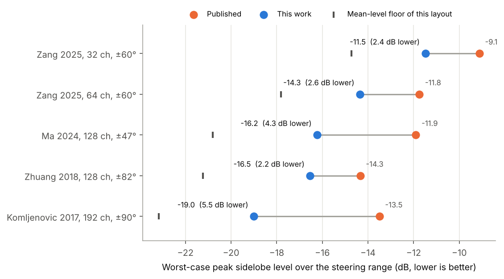
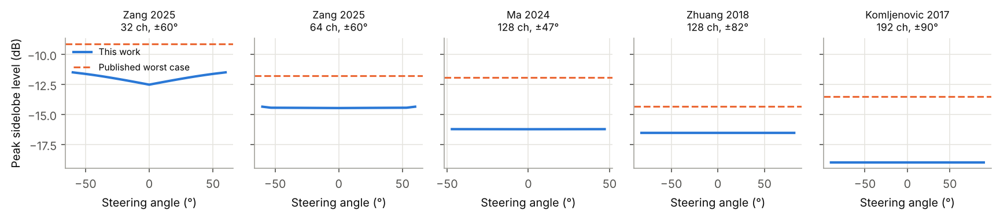
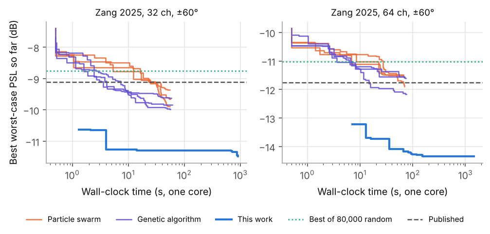
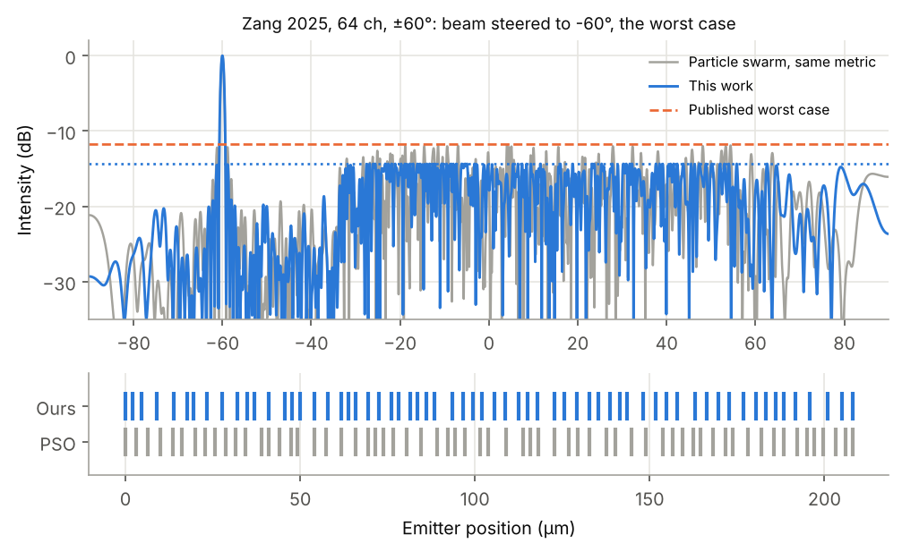
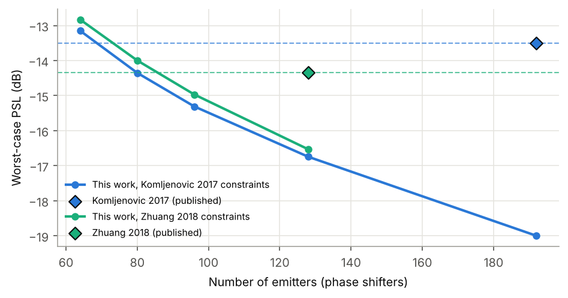
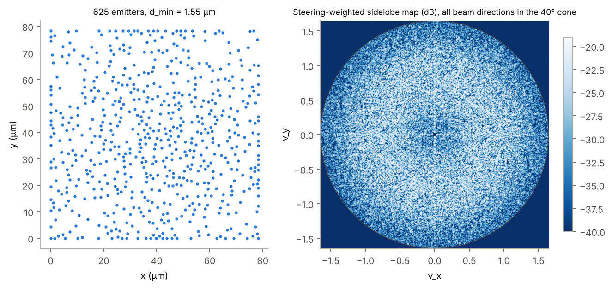
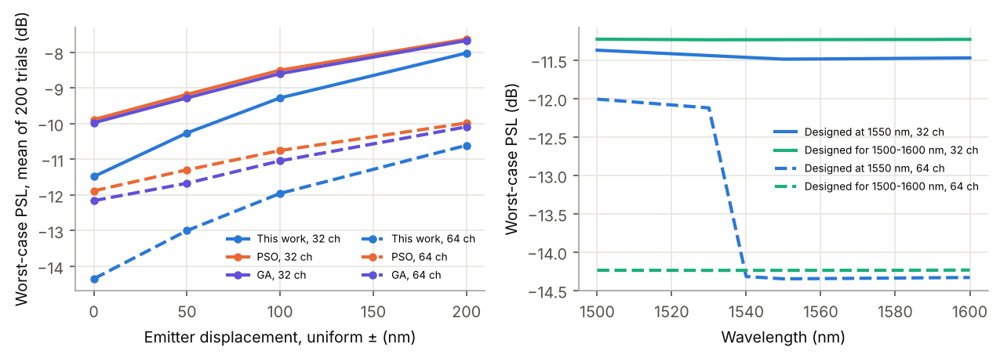

# aperiodic-opa

**Minimax synthesis of sparse, aperiodic optical phased arrays over their whole steering range.**

Silicon optical phased arrays (OPAs) cannot place emitters at half-wavelength pitch without crosstalk, so a
uniform array at a practical pitch fills the field of view with grating lobes. Aperiodic layouts spread
that energy into a sidelobe floor. How low that floor sits at the *worst* pointing direction is the false-echo
margin of a solid-state LiDAR. Published designs place the emitters with particle swarms and genetic
algorithms, judged at a few sampled steering angles. This repository treats layout synthesis as the minimax
problem it is, and solves it.

<p align="center">
  
</p>

On five published designs, restated with **the same emitter count, pitch rules, aperture, element pattern and
steering range**, the worst-case peak sidelobe level (PSL) over the steering range drops by **2.2 to 5.5 dB**:

| Published design | Emitters | Pitch rule | Steering | Published | **This work** |
|---|---|---|---|---|---|
| Zang et al., *Photonics* 2025 (enhanced PSO) | 32 | 2 to 5 µm, 103 µm aperture | ±60° | −9.12 dB | **−11.48 dB** |
| Zang et al., *Photonics* 2025 (enhanced PSO) | 64 | 2 to 5 µm, 208 µm aperture | ±60° | −11.75 dB | **−14.35 dB** |
| Ma et al., *Eng. Res. Express* 2024 (GA) | 128 | 5 to 10 µm | ±47° | −11.9 dB | **−16.22 dB** |
| Zhuang et al., *Opt. Express* 2018 | 128 | ≥ 2.67 λ, 9.75 µm mean | ±82° | −14.34 dB | **−16.53 dB** |
| Komljenovic et al., *Opt. Express* 2017 (PSO) | 192 | ≥ 2.5 µm, 5.2 µm mean | ±90° | −13.5 dB | **−19.00 dB** |

Every number in the right-hand column is the worst case over the **continuous** steering range,
with sidelobe peaks refined to well below 0.001 dB, and is confirmed by an independent evaluator
that steers the beam angle by angle.

**The same sidelobe level with fewer phase shifters.** Under Komljenovic's constraints (1 mm
aperture, 2.5 µm minimum pitch, ±90°), **80 emitters already beat the published 192-emitter
design** (−14.35 vs −13.5 dB): 58 % fewer phase shifters, heaters and drivers. Under Zhuang's
(±82°), 96 emitters beat the published 128.

**Planar arrays too.** A 625-emitter 2-D sparse array (50.5 λ square, 1 λ minimum spacing,
steered over a full 40° cone) reaches **−19.07 dB with uniform amplitudes**. The published design at
the same constraints reaches −12.7 dB with uniform amplitudes, and −17.0 dB only after re-optimising
the amplitude and phase of every emitter for every beam (Gao and Chen, *Electronics* 2024).

## Contents

[How it works](#how-it-works) · [Results](#results) · [Install](#install) · [Usage](#usage) ·
[Reproducing](#reproducing) · [Layout](#repository-layout) · [Limitations](#limitations) ·
[References](#references)

## How it works

**The whole steering range is one problem.** With phase-only steering the far field is
`|E(u)|² |A(u − u₀)|²`: the array factor `A` only shifts with the beam. A sidelobe of `A` at offset `v` is seen at
every beam direction `u₀` with `|u₀ + v| ≤ 1`, with level `|E(u₀ + v)|² / |E(u₀)|²` times `|A(v)|²/N²`. The worst
case over a continuous steering range `[−s, s]` is therefore

```
PSL_worst = max_{v_null ≤ |v| ≤ 1+s}  w(v) |A(v)|² / N²,     w(v) = |E(v − s)|² / |E(s)|²
```

an exact identity for any even, log-concave element pattern (slit, Gaussian, cosⁿ): the worst view of every
sidelobe is with the beam at the opposite edge of the range. The steering dimension disappears, so a design
judged over a continuous ±82° costs no more to optimise than a broadside one. The same holds for planar arrays
over a steering cone. Tests check the identity against a brute-force maximum over steering angles and against
an independent evaluator that steers the beam angle by angle.

**Minimax by sequential linear programming.** At a sidelobe maximum the derivative in `v` vanishes, so each peak
is linear in the emitter positions to first order. Every peak within 10 dB of the worst is linearised, and one
linear program (HiGHS) moves all emitters at once to lower the highest of them, inside the gap and aperture
constraints and a trust region. This is the exchange idea behind Remez filter design, applied to positions; it
drives the active sidelobes to equal height. Ten random starts and an iterated local search (perturb a few
gaps, re-optimise, keep if better) handle the many local minima.

**Planar arrays** add a smooth stage: L-BFGS-B on a soft maximum of the full sidelobe map, whose gradient with
respect to all positions is one type-2 non-uniform FFT per coordinate. Minimum-distance constraints are
linearised exactly, since distance is convex in the separation vector.

Details and derivations: [docs/method.md](docs/method.md).

## Results

All numbers below come from `scripts/make_report.py` and are in [`results/summary.md`](results/summary.md);
every stored layout is in [`results/designs/`](results/designs).

### Published designs at their own constraints

Each case in [`aopa/cases.py`](src/aopa/cases.py) restates a published design with its emitter count,
gap bounds, aperture, element pattern and steering range; where a paper leaves something open, the
choice is recorded there. The minimax layouts hold their level across the whole range, so the worst
angle and the best angle are almost the same:

<p align="center"></p>

| Case | Published (dB) | This work (dB) | Improvement | Mean-level floor of the layout | Search (one core) |
|---|---|---|---|---|---|
| Zang 2025, 32 emitters, ±60° | −9.12 | **−11.48** | 2.36 dB | −14.73 dB | 15 min |
| Zang 2025, 64 emitters, ±60° | −11.75 | **−14.35** | 2.60 dB | −17.81 dB | 30 min |
| Ma 2024, 128 emitters, ±47° | −11.9 | **−16.22** | 4.32 dB | −20.81 dB | 45 min |
| Zhuang 2018, 128 emitters, ±82° | −14.34 | **−16.53** | 2.19 dB | −21.24 dB | 90 min |
| Komljenovic 2017, 192 emitters, ±90° | −13.5 | **−19.00** | 5.50 dB | −23.16 dB | 120 min |

The **mean-level floor** is the average of the steering-weighted sidelobe map of the layout itself, a hard
lower bound on its peak: no layout of `N` equal emitters can push every sidelobe below roughly
`−10 log10 N`, because the sidelobe energy has to go somewhere.

### Same metric, different optimisers

The papers' methods are re-implemented in [`aopa/baselines.py`](src/aopa/baselines.py) and run on
exactly this metric and these constraints: particle swarm (80 particles, inertia 0.9 → 0.3, up to 1000
iterations), a real-coded genetic algorithm, and random search over 80,000 layouts.

<p align="center"></p>

| Case | Particle swarm (best of 3) | Genetic algorithm (best of 3) | Random, best of 80,000 | Published | This work |
|---|---|---|---|---|---|
| Zang 2025, 32 emitters | −9.89 dB | −9.98 dB | −8.76 dB | −9.12 dB | **−11.48 dB** |
| Zang 2025, 64 emitters | −11.88 dB | −12.16 dB | −11.02 dB | −11.75 dB | **−14.35 dB** |

Both metaheuristics land within 0.9 dB of the published numbers, which says the metric here is the
one those papers optimise and the gap is the optimiser. The linear-programming search passes them
within seconds and keeps going.

### What an equal-sidelobe layout looks like

<p align="center"></p>

With the beam pushed to −60°, where the element pattern dims it most, the particle-swarm layout leaves
a few sidelobes standing above the rest; the minimax layout flattens all of them to the same level.

### Fewer channels for the same sidelobe level

<p align="center"></p>

Each emitter in an OPA carries a phase shifter, a heater or modulator, a driver channel and its share of
the calibration. At the published constraints:

| Constraints | Published | Emitters this work needs for the same level |
|---|---|---|
| Komljenovic 2017: 1 mm aperture, ≥ 2.5 µm pitch, ±90° | 192 emitters, −13.5 dB | **80** (−14.35 dB); 64 give −13.15 dB |
| Zhuang 2018: 1.24 mm aperture, ≥ 2.67 λ pitch, ±82° | 128 emitters, −14.34 dB | **96** (−14.97 dB); 80 give −14.00 dB |

### Planar array over a steering cone

<p align="center"></p>

| 625 emitters, 50.5 λ square, d_min = λ, ±40° cone, Gaussian 75° element pattern | Worst-case PSL |
|---|---|
| Gao and Chen 2024, pseudo-random layout, uniform amplitudes | −12.7 dB |
| Gao and Chen 2024, amplitudes and phases optimised per beam by convex optimisation | −17.0 dB |
| Random Poisson-disc layouts here (median and best of 50) | −12.62 / −13.92 dB |
| **This work, uniform amplitudes, phase-only steering** | **−19.07 dB** |

Random layouts reproduce the paper's uniform-amplitude level (−12.6 vs −12.7 dB). The full 40° cone
here is a stricter test than the three steering planes in the paper. The value is confirmed by direct
steered maps in 37 beam directions (−19.07 dB).

### Tolerance

<p align="center"></p>

Equal sidelobes are a sharp optimum: when every sidelobe sits at the limit, random errors push some of
them up. Under the same random displacements, the minimax layouts lose more than the metaheuristic
ones but stay ahead of them:

| Case | Layout | Nominal | ±50 nm | ±100 nm |
|---|---|---|---|---|
| Zang 2025, 32 emitters | this work | −11.48 | −10.26 | −9.28 |
| | particle swarm / genetic | −9.89 / −9.98 | −9.18 / −9.28 | −8.51 / −8.60 |
| Zang 2025, 64 emitters | this work | −14.35 | −13.00 | −11.96 |
| | particle swarm / genetic | −11.88 / −12.16 | −11.30 / −11.67 | −10.75 / −11.04 |

Mean of 200 trials; every emitter is displaced by an independent uniform amount. Waveguides drawn in
one lithography layer are placed far more precisely than ±50 nm relative to each other, so the
nominal numbers are the relevant ones for most processes. The full table, including 10° residual phase
errors, is in [`results/summary.md`](results/summary.md).

Wavelength is a separate matter: a layout optimised at 1550 nm alone can let a lobe into view at the
short end of the band (64 emitters: −12.0 dB at 1500 nm). Optimising over 1500, 1550 and 1600 nm at
once costs 0.1 to 0.3 dB and holds −11.23 dB (32 emitters) and −14.23 dB (64 emitters) across the whole
100 nm band.

### Interactive explorer

[`docs/index.html`](docs/index.html) puts the far fields side by side, live in the browser: pick a
published case, drag the steering angle, and compare the minimax layout with the particle-swarm layout
and a uniform array at the same mean pitch.

## Install

```bash
git clone https://github.com/amasominia/aperiodic-opa
cd aperiodic-opa
pip install -e ".[dev,gds]"
pytest
```

Python 3.10 or later; NumPy, SciPy (HiGHS), finufft and Matplotlib. `gdstk` is optional, for GDS export.

## Usage

```python
import numpy as np
from aopa import Spec, Slit, search, Evaluator, to_gds

spec = Spec(
    name="my-opa",
    n=64,                      # emitters
    gap_min=2.0, gap_max=5.0,  # pitch rules, um
    aperture=208.0,            # um
    steer_deg=60.0,            # steering range +/-60 deg
    pattern=Slit(0.5),         # 500 nm wide waveguide emitter
)
result = search(spec, seconds=600)
print(f"worst-case PSL over +/-60 deg: {result.worst_db:.2f} dB")
to_gds(result.x, "emitters.gds", width=0.5, length=500.0)
```

`Spec(wavelengths=(1.50, 1.55, 1.60), ...)` judges a layout over a band. `aopa.robustness` evaluates
displacement, residual phase error and wavelength drift; `aopa.planar` handles 2-D arrays over a steering
cone.

## Reproducing

```bash
make benchmarks   # five published cases, about 3.3 CPU-hours
make baselines    # particle swarm, genetic algorithm and random search on the same metric
make channels     # fewer emitters, same constraints
make band         # layouts judged over 1500-1600 nm
make planar       # 625-emitter planar array
make robustness
make report       # tables and figures from results/
make explorer     # docs/index.html
```

Every run is cached under `results/`, so `make report` rebuilds every table and figure without re-optimising.
The interactive far-field explorer is [docs/index.html](docs/index.html); to serve it with GitHub Pages, set the
Pages source to the `docs/` folder.

## Repository layout

```
src/aopa/
  spec.py         design specifications, feasibility, random and uniform layouts
  patterns.py     element patterns: isotropic, slit (waveguide emitter), Gaussian
  farfield.py     array factor (NUFFT), the steering-range reduction, peak finding, independent steering scan
  optimize.py     sequential linear programming and iterated local search
  planar.py       2-D arrays over a steering cone: evaluator, smooth stage, LP stage, direct check
  baselines.py    particle swarm, genetic algorithm and random search on the same metric
  robustness.py   displacement, phase error and wavelength tolerance
  cases.py        the published designs as specifications, with sources and assumptions
  layout_io.py    CSV and GDS export
scripts/          run_benchmarks, run_baselines, run_channels, run_planar, run_robustness, make_report, export_explorer
results/          designs, baselines, channel study, planar design, tolerance, figures, summary
docs/             method.md, the explorer (index.html) and its template
tests/            unit tests, including the reduction against brute force
```

## Limitations

* **Reported numbers, not re-scored layouts.** The published layouts are not available, so the
  comparison is with the worst-case levels their authors report from their array-factor models. The
  particle swarm and genetic algorithm re-runs on this metric land within 0.9 dB of those numbers,
  and the metric here is the stricter one (continuous steering range, refined peaks).
* **Some constraints are inferred.** Where a paper leaves a constraint open (element pattern width,
  free or fixed aperture, the exact steering planes in the planar case), the choice is recorded in
  [`aopa/cases.py`](src/aopa/cases.py) and in `scripts/run_planar.py`.
* **Array factor times element pattern.** Mutual coupling, crosstalk between emitters and the
  difference between an analytic far field and a full-wave simulation are not modelled. Zang et al.
  report about 0.3 dB between the two for their designs.
* **Sharp optimum.** Equal-sidelobe layouts are more sensitive to random displacement than the
  metaheuristic ones (see Tolerance), though they stay ahead under the same errors. Judging layouts
  together with a few fixed displaced copies was tried and did not improve tolerance to fresh random
  errors.
* **Uniform amplitudes and continuous phases.** Amplitude tapering and phase-shifter quantisation are
  not part of the design problem.
* **No certificate of global optimality.** The mean-level floor bounds what any layout can reach, and
  the designs sit 3.3 to 4.7 dB above it in one dimension and 7.9 dB in two; how much of that gap is
  reachable is open.
* **Planar compute.** The linear-programming stage for 625 emitters takes about a minute per step on
  one core; the result shown used about 2.5 CPU-hours.

## References

* Z. Zang, J. Wu, Q. Huang, "Design of an aperiodic optical phased array based on the multi-strategy enhanced
  particle swarm optimization algorithm," *Photonics* 12, 210 (2025).
* Ma et al., 128-channel non-uniform silicon nitride OPA, *Eng. Res. Express* (2024), doi:10.1088/2631-8695/ad408b.
* D. Zhuang et al., "Omnidirectional beam steering using aperiodic optical phased array with high error
  margin," *Opt. Express* 26, 19154 (2018).
* T. Komljenovic, R. Helkey, L. Coldren, J. E. Bowers, "Sparse aperiodic arrays for optical beam forming and
  LIDAR," *Opt. Express* 25, 2511 (2017).
* P. Gao, Z. Chen, "Hybrid sparse array design based on pseudo-random algorithm and convex optimization with
  wide beam steering," *Electronics* 13, 4422 (2024).
* D. N. Hutchison et al., "High-resolution aliasing-free optical beam steering," *Optica* 3, 887 (2016).
* A. H. Barnett, J. Magland, L. af Klinteberg, "A parallel nonuniform fast Fourier transform library based on
  an 'exponential of semicircle' kernel," *SIAM J. Sci. Comput.* 41, C479 (2019).

## License

MIT
